

  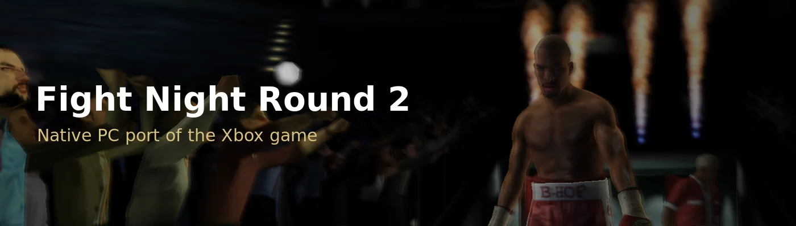

  
  
  

  <a href="#getting-started"><b>Getting started</b></a> &nbsp;·&nbsp;
  <a href="#building"><b>Building</b></a> &nbsp;·&nbsp;
  <a href="https://discord.gg/PQjkKsdtc"><b>Discord</b></a>

  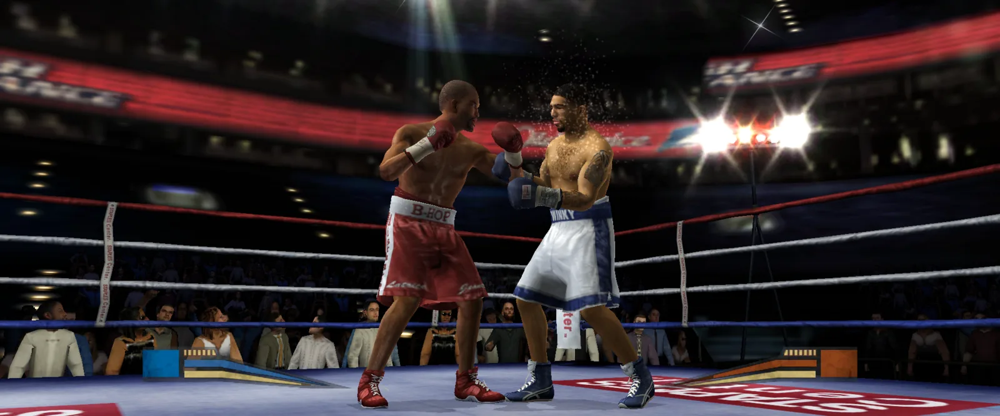

**The 2005 Xbox boxing game, running natively on PC.** This is not an emulator. The game's own x86 code is statically
recompiled with the [Xbox XBE Recomp](https://github.com/TGP482/XboxXBE-Recomp) toolkit into a Windows program, with
a new renderer, sound and input underneath: true widescreen up to 21:9 and beyond, smooth motion at high frame rates,
sharper graphics, mouse and keyboard with Total Punch Control on the mouse, modern pads, and the PC settings a key
away.

> [!NOTE]
> This project does not include any game assets. You need your own copy of the Xbox game to build and play.

## Table of contents

- [Xbox vs. PC](#xbox-vs-pc)
- [Features](#features)
- [Widescreen and the HUD](#widescreen-and-the-hud)
- [Smooth motion](#smooth-motion)
- [PC Settings](#pc-settings)
- [Achievements](#achievements)
- [Graphics settings](#graphics-settings)
- [Controls](#controls)
- [Requirements](#requirements)
- [Getting started](#getting-started)
- [FAQ](#faq)
- [Known issues](#known-issues)
- [Roadmap](#roadmap)
- [Community and support](#community-and-support)
- [Building](#building)
- [Credits and legal](#credits-and-legal)

## Xbox vs. PC
[(Back to top)](#table-of-contents)

  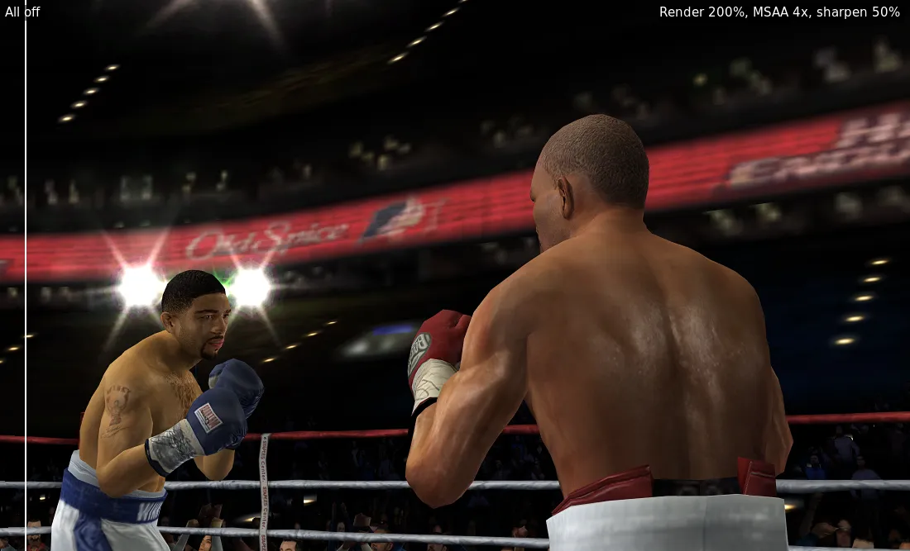
   
  <i>All extras off vs. render scale 200%, MSAA 4x and sharpening 50%, at 1920x800 (21:9).</i>

The Xbox drew Fight Night Round 2 at 640x480, at 4:3 or squeezed for a 16:9 TV, with the fights moving 50 times a
second. The port draws it at your screen's resolution and shape, with anti-aliasing and sharpening layered on top of
the game's own picture, and with smooth motion on, the fights at your frame rate.

## Features
[(Back to top)](#table-of-contents)

| | |
|---|---|
| **Widescreen** | True proportions on any screen, 21:9 and wider included. The fights fill the screen with the arena's view widened; the menus keep their 16:9 shape in the middle with a dimmed, blurred copy filling the sides, and the sides open out over half a second as a fight starts. |
| **Aspect, changed as you play** | From the screen's shape, 16:9 or fill the screen, applied at once, mid-fight too. |
| **HUD in proportion** | The health and stamina bars, the menus and the button pictures keep their shape and size on any screen: on a wide one they stay where a 16:9 TV shows them, never stretched. **F9** hides the HUD for screenshots. |
| **Smooth motion** | The game moves its fighters 50 times a second; turned on, the fights are drawn with frames in between, up to your frame rate cap: the camera and the ring glide at 144 or 240 frames a second. The game's speed is unchanged. |
| **Sharper graphics** | Render scale up to 200%, MSAA up to 8x, FXAA or SMAA, sharpening, anisotropic filtering, enhanced textures, and sharp text and HUD. |
| **PC Settings** | **F1** opens the settings window anywhere, over the game; the main ones are also in the game's own menus: **X** on Options and **X** on the pause menu. Saved in `settings.toml`. |
| **Achievements** | 10, for the Career's wins, knockouts and belts, a created champ, the fight store and a retirement, kept in `achievements.toml` beside the game. |
| **Unlock everything** | One setting (the **Game** page) makes every venue, boxer, and Create Champ and fight store item available; your save keeps its own progress. |
| **Mouse and keyboard** | Total Punch Control on the mouse: flick it for jabs, hooks and uppercuts, as the right stick. WASD moves, Shift leans, Space or the right mouse button blocks. |
| **Mouse in the menus** | Click to choose, right click goes back, the wheel moves the selection. |
| **Controllers** | Xbox, PlayStation and Switch pads with hot plugging and rumble. **Modern button pictures** show today's Xbox pad: LB and RB for White and Black, LT and RT, View and Menu. |
| **Quality of life** | Skip the intro movies, Quit Game on the title menu, hide the HUD (F9), F12 screenshots at full resolution, Alt+Enter for full screen, English, German or French, an optional boot splash (`splash.png` beside the game). |

## Widescreen and the HUD
[(Back to top)](#table-of-contents)

  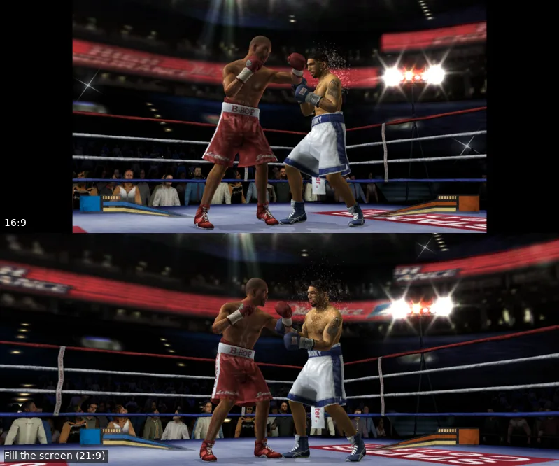
   
  <i>ASPECT RATIO: 16:9 and fill the screen (21:9), in a 1920x800 window, half a second apart.</i>

In a fight the arena's view is widened to your screen's shape. The HUD, the menus and the button pictures are laid out
for 16:9 and keep that shape and size: on a wider screen they stay where a 16:9 TV shows them, and on a 4:3 or 16:10
screen the whole 16:9 picture fits with black above and below, so nothing is stretched or squeezed. The aspect can be
changed in the settings while you fight, and the view follows at once; a 4:3 choice shows 16:9.

  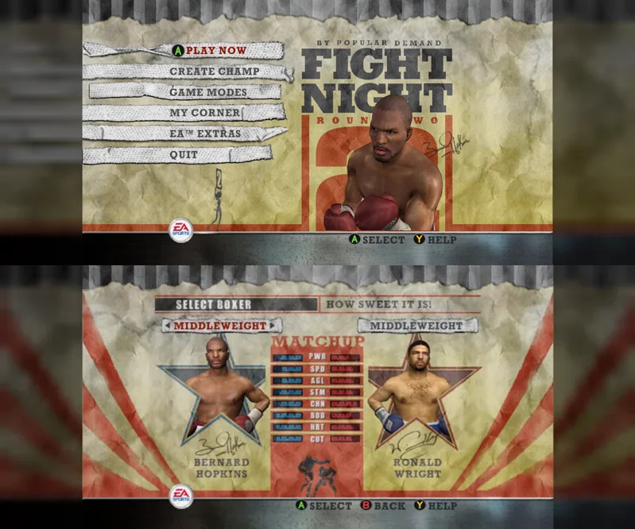
   
  <i>The menus keep their 16:9 shape on a wide screen, a dimmed, blurred copy at the sides.</i>

From the menus into a fight, the picture does not jump to the wider shape: the arena's sides open out over about half a
second.

The walk-ins, the replays and the knockdowns fill the screen as the fights do. The movies keep their 4:3 shape, with black at the sides.

## Smooth motion
[(Back to top)](#table-of-contents)

The game moves its boxers 50 times a second, as on a PAL Xbox. With **Smooth motion** on (the settings window's
**Game** page) and a frame rate cap above 50, the fights get frames in between the game's own: the camera, the ring
and the crowd move at your frame rate, 144 or 240 frames a second on a fast screen. The boxers move with the camera
and pose at the game's 50 a second, which keeps their skin whole on every graphics card. The menus stay as the game
draws them. A cap of 100 or more shows it best (on a 280 Hz screen, 140 or 280).

## PC Settings
[(Back to top)](#table-of-contents)

  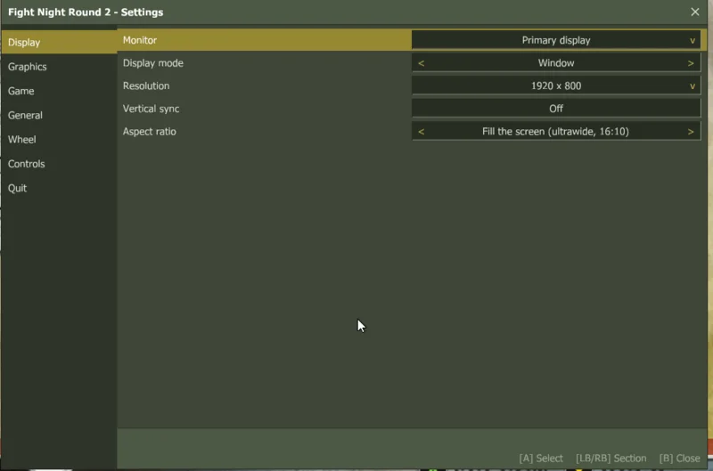
   
  <i>The settings window (F1): Display, Graphics and Game.</i>

**F1** (or Back + Start on a pad) opens the settings window over the game, in the menus or a fight. LB and RB (or
Page Up and Page Down) change its page; changes apply at once unless the page says otherwise.

| Page | Settings |
|---|---|
| **Display** | Monitor, display mode (full screen, borderless, window), resolution, vertical sync, aspect ratio |
| **Graphics** | Render scale, texture filtering, frame rate cap, MSAA, smooth alpha edges, edge smoothing (FXAA, SMAA), scaling filter, enhanced textures, sharpening, CRT look, low latency, frames a second shown, sharp text and HUD, the renderer (Direct3D 12 or 11) |
| **Game** | Language (English, German, French), modern button pictures, skip intro movies, hide the HUD, smooth motion, unlock everything |
| **General**, **Controls** | Pausing when the window is not in front; key and button bindings, the mouse and the sticks |

Everything is saved in `settings.toml` beside the game.

  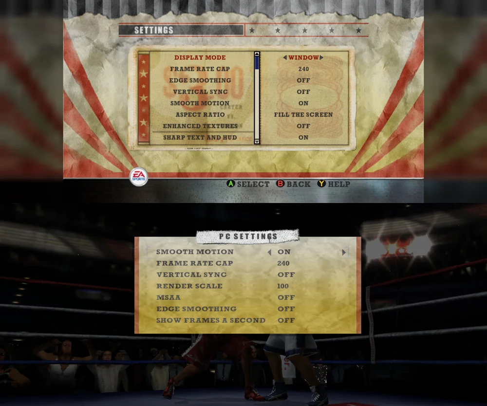
   
  <i>The PC settings in the game's own menus: X on Options (My Corner), and X on the pause menu in a fight.</i>

The main PC settings are in the game's own menus too, in its style and with the pad. **X** on Options (My Corner >
Options) opens the Settings screen with the PC settings in place of the game's: display mode, frame rate cap, edge
smoothing, vertical sync, smooth motion, aspect ratio and more; A keeps the changes, B leaves them. **X** on the pause
menu in a fight opens a PC SETTINGS panel with smooth motion, frame rate cap, vertical sync, render scale, MSAA, edge
smoothing and the frames a second shown.

## Achievements
[(Back to top)](#table-of-contents)

10 achievements, 315 points, kept in `achievements.toml` beside the game. The settings window's **Achievements** page
lists them with your unlocks.

| Achievement | How | Points |
|---|---|---|
| Turning Pro / Lights Out | Win your first professional fight in Career / win one by knockout | 10 each |
| Contender / Knockout Artist | Win 10 professional fights / score 10 knockouts in one Career | 25 each |
| Perfect Record | Go 10-0 as a professional | 50 |
| Champion / Undisputed | Win a title belt / hold three at once | 50 / 100 |
| Self Made | Create a champ | 10 |
| Dressed to Win | Buy something in the fight store | 10 |
| Hang Them Up | Retire a boxer at the end of a Career | 25 |

## Graphics settings
[(Back to top)](#table-of-contents)

Shots of one paused instant replay at the Staples Center at 1920x800, taken one after another on an Intel Arc A750;
the close-ups of the ring's corner post and ropes are enlarged twice.

  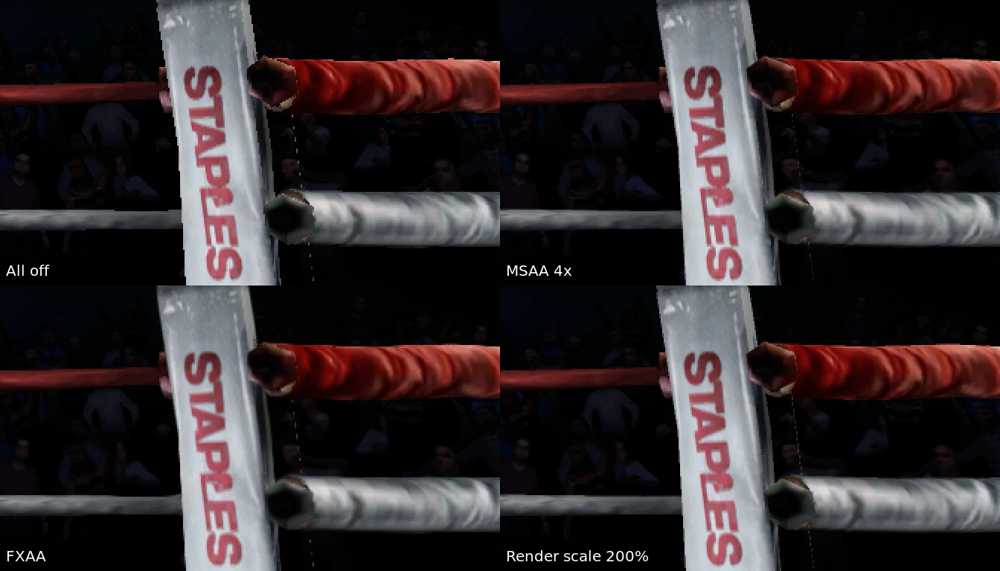
   
  <i>Edges: all off, MSAA 4x, FXAA and render scale 200%.</i>

- **MSAA** smooths the edges of the 3D scene and keeps textures sharp. The more samples, the slower.

  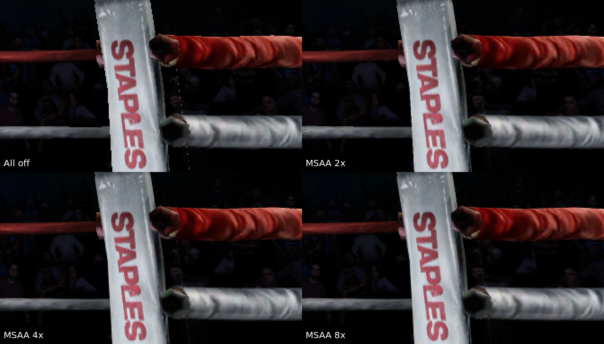
   
  <i>MSAA off, 2x, 4x and 8x.</i>

- **Edge smoothing** works on the finished frame, HUD included: FXAA softens it a little, SMAA keeps it crisper.

  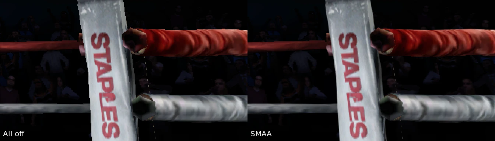
   
  <i>Edge smoothing off vs. SMAA.</i>

- **Render scale** draws the picture larger than the screen: the smoothest fine detail, and the slowest.
- **Sharpening** makes the picture crisper. Around 50% is a good start.

  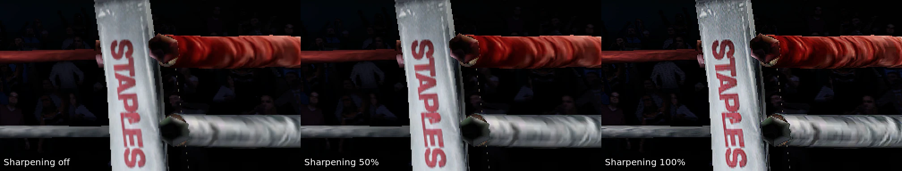
   
  <i>Sharpening off, 50% and 100%.</i>

- **Smooth alpha edges** soften the crowd's and the ring's cut-out textures, with MSAA on.
- **Texture filtering** keeps the canvas and the crowd sharp at an angle.
- **Scaling filter** chooses how the frame reaches the screen when render scale is not 100%: bilinear, or sharp.
- **Enhanced world textures** double the 3D scene's textures in the background. They use more video memory and can
  cause a brief hitch as new ones appear.

## Controls
[(Back to top)](#table-of-contents)

The game's default controls (My Corner > Options > Controls, configuration 1). In a fight the mouse is the right
stick: Total Punch Control's punches are its flicks.

| Action | Keyboard and mouse | Pad |
|---|---|---|
| Move | W A S D, arrows | left stick, d-pad |
| Punch (Total Punch Control: jabs, hooks, uppercuts) | mouse flicks, I J K L | right stick |
| Lean; with a punch, to the body | Shift | LT |
| Block | Space, right mouse button | RT |
| Signature punch | F, E | A, LB |
| Illegal blow | G, R | B, RB |
| Taunt | T | X |
| Clinch | C | Y |
| Pause | Esc, P | Menu |
| Hide the HUD | F9 | |
| Screenshot | F12 | |
| Settings window | F1 | Back + Start |
| Full screen | Alt+Enter | |
| Menus | click to choose, right click goes back, the wheel moves the selection; or arrows, Enter and Backspace | d-pad, A, B |

Keys and buttons can be changed in the settings window's **Controls** page.

## Requirements
[(Back to top)](#table-of-contents)

- **Your own copy of the game:** the European Xbox release (PAL), title id 45410055, `default.xbe` SHA-1
  `8edb378c6f3d9f984751c0a58060485bda189c76`. An `.iso` image of your disc, or a folder with its files.
- **Windows 10 or 11, 64 bit**, and a graphics card with Direct3D 12 (Direct3D 11 also works).
- **Tested on AMD and Intel Arc graphics:** an AMD Radeon RX 7900 XT and an Intel Arc A750. NVIDIA cards are expected
  to work, as nothing here is specific to a vendor, but have not been tested yet: please report how yours runs.
- **Minimum spec:** any 64 bit processor from the last ten years and a Direct3D 12 graphics card run the game at its
  own pace; smooth motion at 144 frames a second and more wants a recent graphics card.

## Getting started
[(Back to top)](#table-of-contents)

`FightNight2Launcher.exe` does everything for you: no Visual Studio, no Git, no command line, nothing installed in
Windows and no admin rights needed. It and a build from source both make the game's code on your own PC from your own
disc: it is never downloaded, only the program around it.

1. Download `FightNight2Launcher.exe` from the [latest release](https://github.com/hk21x/fightnight2-recomp/releases/latest).
2. Put it in a folder of its own with a short path (for example `C:\Games\FightNight2`) and run it. Everything it makes
   goes in a `FightNight2` folder beside it. Windows may warn about an unrecognised app: choose **More info**, then
   **Run anyway**.
3. **Your game:** choose your disc image (`.iso`) or the folder with the disc's files. The launcher checks that it is
   the supported release (Europe).
4. **Get the game ready:** the launcher downloads the game's package (the program and a compiler, no game code), then
   your PC builds the game's code from your disc, in about a minute. You can stop at any time; it carries on where it
   left off.
5. **Play.** In the game, **F1** opens the PC settings.

When a new release is out, the launcher offers it at the top of its window: **Update the launcher**, then **Update**.
The game is built again with the new version, keeping your saves and settings.

Files, all under the `FightNight2` folder beside the launcher:
- `play\`: `FightNight2.exe`, `FightNight2.dll` (the game's code, built on your PC), `settings.toml`, `hdd\` (your
  saves and records), `logs\`, `screenshots\`, `compiler\`
- `launcher.log`, the launcher's log (send it with any problem)

To remove everything, delete the launcher and its `FightNight2` folder (keep `play\hdd` if you want your saves).

## FAQ
[(Back to top)](#table-of-contents)

<b>Is this an emulator?</b>

 
No. The game's x86 code is translated ahead of time into C++ and built as a Windows program. The Xbox's graphics,
sound and input are rebuilt for the PC underneath it. That is what makes true widescreen with the HUD in proportion,
smooth motion at high frame rates and Total Punch Control on the mouse possible.

<b>Why do I need my own copy of the game?</b>

 
The game belongs to its rights holders. This project shares only its own work: the game's code and assets are made
from your disc when you build.

<b>Smooth motion is on, but the fights look no smoother.</b>

 
Smooth motion draws frames in between up to the frame rate cap: set the cap (F1, <b>Graphics</b>) to 100 or more,
with vertical sync off or a fast screen. With a cap of 60 there is little room for frames in between.

<b>Something is wrong. What should I send?</b>

 
The first lines of the log in <code>logs\</code> beside the game list your settings and GPU. Please include that file
when you report a problem on the <a href="https://discord.gg/PQjkKsdtc">Discord server</a>.

## Known issues
[(Back to top)](#table-of-contents)

- **Smooth motion:** the boxers' limbs move at the game's 50 a second while the camera and the ring are smooth.
- **My Gym:** the drills' instruction pop-ups stay at 16:9 in the middle of a wide screen.
- **Not yet covered by testing:** NVIDIA graphics cards.

## Roadmap
[(Back to top)](#table-of-contents)

- **The boxers' limbs smooth too** with smooth motion, on every graphics card.

## Community and support
[(Back to top)](#table-of-contents)

Join the [Discord server](https://discord.gg/PQjkKsdtc) for help getting the game running, to report problems, and
to talk about the port with other players.

## Building
[(Back to top)](#table-of-contents)

For developers.

1. Clone with submodules: `git clone --recurse-submodules https://github.com/hk21x/fightnight2-recomp`.
2. Put your disc in `assets`: an `.iso`, or `default.xbe` with the game's folders beside it.
3. Install Visual Studio 2022 with **Desktop development with C++**, **C++ Clang tools for Windows** and **C++ CMake
   tools for Windows** (`build.bat` offers to add the last two), and run `build.bat`. The first build recompiles the
   game and takes a while. `FightNight2.exe` is in `out\build\release`.

## Credits and legal
[(Back to top)](#table-of-contents)

- [Xbox XBE Recomp](https://github.com/TGP482/XboxXBE-Recomp), the recompiler and runtime this is built on.
- [XenonRecomp](https://github.com/hedge-dev/XenonRecomp) for the overridable function layout and instruction hooks.
- [Zydis](https://github.com/zyantific/zydis) for decoding x86 instructions, [toml++](https://github.com/marzer/tomlplusplus)
  for the configs, [Dear ImGui](https://github.com/ocornut/imgui) for the settings overlay and
  [SDL](https://github.com/libsdl-org/SDL) for the window, input and controllers.

*Fight Night Round 2* © its respective rights holders. Developed by EA Chicago and published by Electronic Arts. This
is an unofficial fan project, not affiliated with or endorsed by them or by the boxers. No game code or assets are
distributed: they are made from your own copy of the game.
